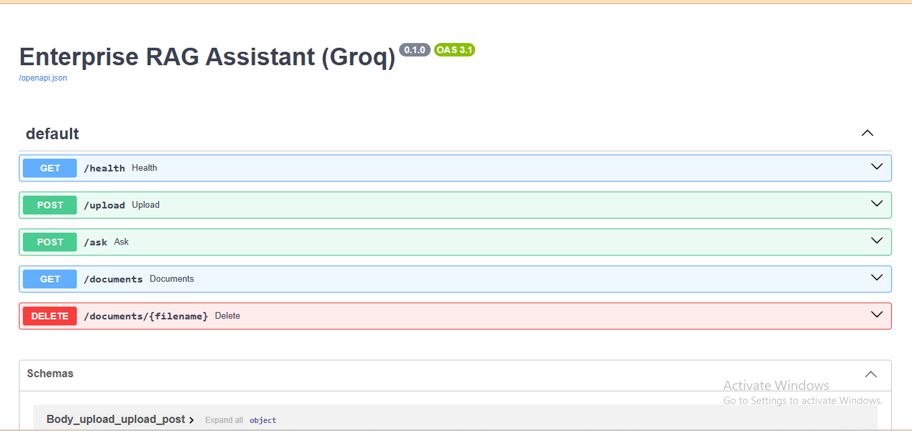
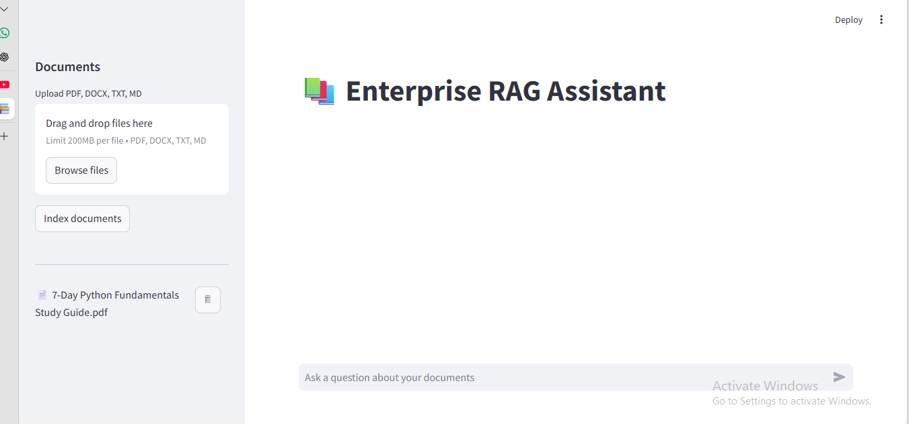
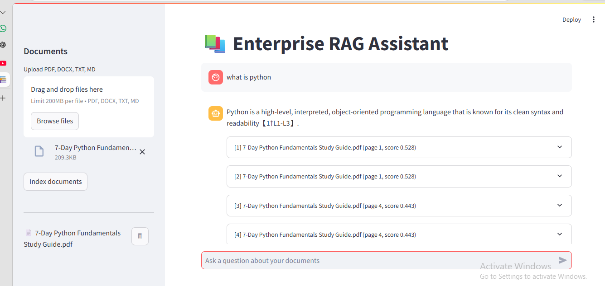

# Enterprise RAG Assistant (Groq)

Stack: FastAPI + Streamlit + ChromaDB + Groq (LLM) + sentence-transformers (local embeddings) + Docker.

## Run with Docker
    cp .env.example .env   # add GROQ_API_KEY
    docker compose up --build
UI: http://localhost:8501  |  API docs: http://localhost:8000/docs

## Run locally
    pip install -r requirements.txt
    uvicorn backend.main:app --reload
    streamlit run frontend/app.py
# 📚 Enterprise RAG Assistant

An AI-powered document Q&A application that lets you upload documents, run semantic search over them, and get accurate, context-aware answers **with source references**, using Retrieval-Augmented Generation (RAG).

Built with **Python, FastAPI, Streamlit, Groq, ChromaDB, and Docker**.


---

## 📸 Screenshots

### Main Interface


### Document Upload


### Answer with Sources


---

## ✨ Features

- 📄 **Multi-format uploads**: PDF, DOCX, TXT, and Markdown
- 🔍 **Semantic search** using local sentence-transformer embeddings stored in ChromaDB
- 🤖 **Fast LLM answers** powered by the Groq API (Llama 3.3 70B by default)
- 📎 **Source citations**: every answer links back to the file, page, similarity score, and snippet
- 💬 **Conversational chat** with short-term memory for follow-up questions
- 🗂️ **Document management**: list and delete indexed documents from the UI
- 🐳 **One-command deployment** with Docker Compose
- 💾 **Persistent vector store** across restarts

---

## 🏗️ Architecture

```
┌──────────────┐   HTTP    ┌──────────────────────────────────────┐
│  Streamlit   │ ────────► │              FastAPI                 │
│   Frontend   │ ◄──────── │  /upload  /ask  /documents  /health  │
└──────────────┘           └───────┬──────────────────┬───────────┘
                                   │                  │
                       ┌───────────▼──────┐   ┌───────▼────────┐
                       │ Loader + Chunker │   │  RAG Pipeline  │
                       │ (PDF/DOCX/TXT)   │   │ retrieve → LLM │
                       └───────────┬──────┘   └───────┬────────┘
                                   │                  │
                       ┌───────────▼──────┐   ┌───────▼────────┐
                       │ sentence-        │   │   Groq API     │
                       │ transformers     │   │ (Llama 3.3)    │
                       └───────────┬──────┘   └────────────────┘
                                   │
                           ┌───────▼───────┐
                           │   ChromaDB    │
                           └───────────────┘
```

**How it works**

1. **Ingest**: uploaded files are parsed, split into overlapping chunks, embedded locally, and stored in ChromaDB with metadata (source, page).
2. **Retrieve**: the user's question is embedded and the top-K most similar chunks are fetched.
3. **Generate**: the chunks are passed as numbered context to Groq, which answers using only that context and cites sources as `[1]`, `[2]`, etc.

> Groq does not provide an embeddings endpoint, so embeddings are generated locally with `sentence-transformers/all-MiniLM-L6-v2`.

---

## 📁 Project Structure

```
enterprise-rag/
├── backend/
│   ├── main.py              # FastAPI app and routes
│   ├── rag.py               # Retrieval + Groq answer generation
│   ├── vector_store.py      # ChromaDB + embeddings
│   ├── document_loader.py   # File parsing and chunking
│   └── config.py            # Environment-based settings
├── frontend/
│   └── app.py               # Streamlit UI
├── Dockerfile
├── docker-compose.yml
├── requirements.txt
├── .env.example
└── README.md
```

---

## 🚀 Getting Started

### Prerequisites

- A free [Groq API key](https://console.groq.com/keys)
- Docker Desktop **or** Python 3.10+

### Option 1: Docker (recommended)

```bash
git clone https://github.com/<your-username>/enterprise-rag.git
cd enterprise-rag

cp .env.example .env        # then set GROQ_API_KEY
docker compose up --build
```

| Service      | URL                          |
| ------------ | ---------------------------- |
| Streamlit UI | http://localhost:8501        |
| API docs     | http://localhost:8000/docs   |

Stop with `Ctrl+C` or `docker compose down`.

### Option 2: Run locally

```bash
python -m venv venv
source venv/bin/activate        # Windows: venv\Scripts\activate
pip install -r requirements.txt

cp .env.example .env            # then set GROQ_API_KEY
```

Run the backend and frontend in two separate terminals:

```bash
# Terminal 1
uvicorn backend.main:app --reload --port 8000

# Terminal 2
streamlit run frontend/app.py
```

---

## ⚙️ Configuration

Set these in your `.env` file:

| Variable          | Description                          | Default                                    |
| ----------------- | ------------------------------------ | ------------------------------------------ |
| `GROQ_API_KEY`    | Your Groq API key (**required**)     | none                                       |
| `GROQ_MODEL`      | Groq model used for answers          | `llama-3.3-70b-versatile`                  |
| `EMBEDDING_MODEL` | Local embedding model                | `sentence-transformers/all-MiniLM-L6-v2`   |
| `CHROMA_DIR`      | ChromaDB persistence directory       | `./chroma_db`                              |
| `BACKEND_URL`     | Backend URL used by the Streamlit UI | `http://localhost:8000`                    |

Chunking and retrieval settings (`CHUNK_SIZE`, `CHUNK_OVERLAP`, `TOP_K`) live in `backend/config.py`.

---

## 🔌 API Reference

| Method   | Endpoint                | Description                              |
| -------- | ----------------------- | ---------------------------------------- |
| `GET`    | `/health`               | Health check                             |
| `POST`   | `/upload`               | Upload and index a document (multipart)  |
| `POST`   | `/ask`                  | Ask a question, returns answer + sources |
| `GET`    | `/documents`            | List indexed documents                   |
| `DELETE` | `/documents/{filename}` | Remove a document from the index         |

**Example**

```bash
curl -X POST http://localhost:8000/upload -F "file=@report.pdf"

curl -X POST http://localhost:8000/ask \
  -H "Content-Type: application/json" \
  -d '{"question": "What are the key findings?"}'
```

**Response**

```json
{
  "answer": "The key findings are ... [1][2]",
  "sources": [
    { "id": 1, "source": "report.pdf", "page": 4, "score": 0.82, "snippet": "..." }
  ]
}
```

---

## 🛠️ Troubleshooting

- **"Backend not reachable"**: confirm the backend is running at `http://localhost:8000/health`.
- **Groq authentication error**: check `GROQ_API_KEY` in `.env`, then restart the services.
- **Slow first start**: the embedding model downloads once and is cached afterward.
- **Port in use**: change the host port in `docker-compose.yml`, e.g. `"8502:8501"`.

---

## 🗺️ Roadmap

- [ ] Streaming responses
- [ ] API authentication
- [ ] Per-user document collections
- [ ] OCR support for scanned PDFs
- [ ] Hybrid search (BM25 + vector) with re-ranking

---

## 🤝 Contributing

Contributions are welcome. Fork the repo, create a feature branch, and open a pull request.


